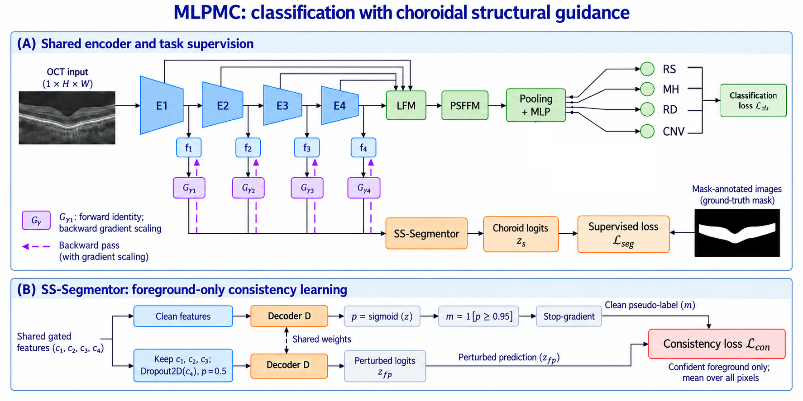

# MLPMC: Multi-Label Pathology Multi-Task Classification and Segmentation for Retinal OCT

Official PyTorch implementation of the final paper model (**MLPMC-Net**) and trainer (**`nnUNetTrainercls_mlpmc_final`**).

---

## 📑 Table of Contents
- [Overview](#-overview)
- [Method Highlights](#-method-highlights)
- [Repository Structure](#-repository-structure)
- [Installation Guide](#-complete-setup--installation-guide)
- [Training Guide](#-training-guide)
- [Evaluation & Reproducibility](#-evaluation--reproducibility)
- [Interpretability with Grad-CAM](#-interpretability-with-grad-cam)
- [Acknowledgements](#-acknowledgements)
- [Citation](#-citation)

---

## 🔬 Overview

Optical Coherence Tomography (OCT) is the clinical gold standard for non-invasive cross-sectional imaging of the retina. In real-world clinical screening, eyes often present with multiple co-occurring pathologies rather than isolated conditions. This repository implements **MLPMC** (*Multi-Label Pathology Multi-Task Classification and Segmentation*), a joint deep learning framework designed to simultaneously:
1. Identify multiple co-occurring retinal pathologies:
   * **RS**: Retinoschisis
   * **MH**: Macular Hole
   * **RD**: Retinal Detachment
   * **CNV**: Choroidal Neovascularization
2. Provide high-resolution anatomical localization via **Choroid Segmentation**.
3. Leverage abundant weakly-labeled or unlabeled scans through **semi-supervised feature-perturbation consistency**.

---

## 🌟 Method Highlights

<p align="center">
  
</p>
<p align="center">
  <em>Figure 1: Architectural framework of MLPMC (Classification with Choroidal Structural Guidance). <strong>(A) Shared encoder and task supervision:</strong> Shared multi-scale encoder with backward gradient scaling ($G_\gamma$), Lateral Feature Modules (LFM), Pathology-Specific Feature Fusion Module (PSFFM), and joint classification & segmentation task supervision. <strong>(B) SS-Segmentor: foreground-only consistency learning:</strong> Dual-branch consistency learning enforcing confident foreground predictions against feature dropout perturbations on unlabeled scans.</em>
</p>

### (A) Shared Encoder & Multi-Task Supervision
1. **Shared Encoder ($E_1, E_2, E_3, E_4$)**:
   A single ResNet-50 backbone is shared across both classification and segmentation tasks, extracting hierarchical feature taps ($f_1, f_2, f_3, f_4$).
2. **Backward Gradient Scaling ($G_{\gamma_1}, G_{\gamma_2}, G_{\gamma_3}, G_{\gamma_4}$)**:
   Maintains forward identity pass while scaling backward gradients from the segmentation task back into the encoder using a depth-decay schedule $(\gamma = [1.0, 1.0, 0.15, 0.0])$. Classification maintains 100% gradient authority over deep semantic disease features while segmentation nudges shallow representations.
3. **LFM & Pathology-Specific Feature Fusion Module (PSFFM)**:
   Multi-scale features are aggregated across stages via Lateral Feature Modules (LFM) and fused using channel Squeeze-and-Excitation attention with feature variance spatial attention (PSFFM) before global pooling and MLP classification.
4. **Multi-Label Pathology Prediction**:
   Outputs independent probability logits for the 4 target retinal conditions:
   * **RS**: Retinoschisis
   * **MH**: Macular Hole
   * **RD**: Retinal Detachment
   * **CNV**: Choroidal Neovascularization
   Optimized with multi-label Focal Loss $\mathcal{L}_{cls}$ to handle class co-occurrence and severe imbalance.

### (B) SS-Segmentor: Foreground-Only Consistency Learning
1. **Clean Feature Pathway**:
   Clean encoder features $(c_1, c_2, c_3, c_4)$ pass through Decoder $D$ to compute choroid logits $z$ and soft probabilities $p = \text{sigmoid}(z)$. Scans with choroid ground-truth masks are optimized via supervised loss $\mathcal{L}_{seg}$.
2. **Confidence Thresholding & Stop-Gradient**:
   For unlabeled or weakly-labeled scans, high-confidence foreground predictions ($p \ge 0.95$) are filtered via hard thresholding ($m = \mathbf{1}[p \ge 0.95]$) and detached using stop-gradient to form clean pseudo-labels.
3. **Perturbed Feature Pathway**:
   Shallow features ($c_1, c_2, c_3$) are kept intact while feature dropout perturbation ($\text{Dropout2D}(c_4), p=0.5$) is applied to the deepest feature map before entering Decoder $D$, producing perturbed predictions $z_{fp}$.
4. **Foreground-Only Consistency Loss ($\mathcal{L}_{con}$)**:
   Penalizes divergence between clean pseudo-labels and perturbed predictions exclusively over confident foreground pixels, weighted by a dynamic sigmoid ramp-up schedule $\lambda(t)$.

---

## 📁 Repository Structure

```
MLPMC_Net/
├── Figure_2_final.png                # Architecture framework diagram (Figure 1 in paper)
├── configs/                          # Dataset & Split Schemas
│   ├── dataset_template.json         # nnU-Net dataset description template
│   └── splits_semi_example.json      # 5-fold cross-validation split template
│
├── custom_nnunet/                    # Custom Extensions for Official nnU-Net v2
│   ├── dataloading/
│   │   ├── nnunet_dataset.py         # Multi-task [seg, cls] dataset & augmentation views
│   │   └── data_loader_2d.py         # Multi-task 2D batch generator with class labels
│   └── variants/
│       └── nnUNetTrainercls_mlpmc_final.py  # Registered trainer variant for nnUNetv2_train CLI
│
├── models/                           # Core Model Architecture
│   ├── __init__.py                   # Model exports
│   └── mlpmc_net.py                  # Main MLPMCNet, ClsHead, SegHead, grad_scale, PSFFM
│
├── training/                         # Training Package
│   ├── __init__.py
│   ├── trainer_mlpmc.py              # MLPMC Trainer (nnUNetTrainercls_mlpmc_final)
│   └── losses.py                     # Multi-label Focal Loss, DC_and_BCE_loss, consistency schedule
│
├── scripts/                          # Reproducibility & Utility Scripts
│   ├── install_extensions.py         # Automated installer for nnU-Net custom extensions
│   ├── run_training.py               # Standalone training launcher (zero modification needed)
│   ├── verify_model.py               # Architecture self-test verifying forward/backward passes
│   ├── evaluate.py                   # Evaluation script for validation Macro-F1, per-class, Dice
│   ├── gradcam.py                    # Class activation map visualization (Grad-CAM / Grad-CAM++)
│   └── train.sh                      # Shell runner for 5-fold training
│
├── requirements.txt                  # Python dependencies (includes official nnunetv2)
├── setup.py                          # MLPMC package installer
└── README.md                         # Documentation
```

---

## 💻 Complete Setup & Installation Guide

### Step 1: Clone the Repository
```bash
git clone https://github.com/TauhidScu/MLPMC_Net.git
cd MLPMC_Net
```

### Step 2: Create and Activate a Conda Environment
We recommend Python 3.10:
```bash
conda create -n mlpmc python=3.10 -y
conda activate mlpmc
```

### Step 3: Install PyTorch with CUDA
Install PyTorch matching your system's CUDA version (e.g., CUDA 11.8 or 12.1):
```bash
# For CUDA 11.8
pip install torch torchvision --index-url https://download.pytorch.org/whl/cu118

# For CUDA 12.1
pip install torch torchvision --index-url https://download.pytorch.org/whl/cu121
```

### Step 4: Install Dependencies & Official nnU-Net v2
Install the requirements (which includes official `nnunetv2`) and the MLPMC package in editable mode:
```bash
pip install -r requirements.txt
pip install -e .
```
*(Alternatively, you can install official nnU-Net directly from DKFZ: `pip install git+https://github.com/MIC-DKFZ/nnUNet.git`)*

### Step 5: Install MLPMC Custom Extensions into nnU-Net
To enable multi-task data loading and register the `nnUNetTrainercls_mlpmc_final` trainer into your installed `nnunetv2` environment, run the extension installer:
```bash
python scripts/install_extensions.py
```
> **What this does:**
> 1. Auto-detects your active Python environment's `nnunetv2` installation directory.
> 2. Safely backs up original files with `.backup_orig`.
> 3. Installs the multi-task `nnunet_dataset.py` and `data_loader_2d.py` into `nnunetv2/training/dataloading/`.
> 4. Registers `nnUNetTrainercls_mlpmc_final.py` into `nnunetv2/training/nnUNetTrainer/variants/`.
>
> *(To restore original nnU-Net files at any time, run: `python scripts/install_extensions.py --uninstall`)*

### Step 6: Verify the Model Architecture
Run the self-verification script to confirm that the model, forward pass, and backward gradient routing function properly:
```bash
python scripts/verify_model.py
```

---

## 🚀 Training Guide

### 1. Set nnU-Net Paths
Set the standard nnU-Net environment variables pointing to your data and results directories:
```bash
export nnUNet_raw="/path/to/nnUNet_raw"
export nnUNet_preprocessed="/path/to/nnUNet_preprocessed"
export nnUNet_results="/path/to/nnUNet_results"
```
*(Or use a local directory: `mkdir -p data/nnUNet_raw data/nnUNet_preprocessed data/nnUNet_results` and export paths accordingly).*

### 2. Five-Fold Cross-Validation Training

You can launch training using either the provided standalone script or the standard nnU-Net CLI.

#### Option 1: Standalone Launcher (Recommended)
Use `scripts/run_training.py`. This script directly imports the MLPMC trainer and runs the exact nnU-Net training pipeline without needing to copy files into your python environment.

To run the complete 5-fold cross-validation:
```bash
# Train Folds 0 through 4:
CUDA_VISIBLE_DEVICES=0 python scripts/run_training.py 702 2d 0
CUDA_VISIBLE_DEVICES=0 python scripts/run_training.py 702 2d 1
CUDA_VISIBLE_DEVICES=0 python scripts/run_training.py 702 2d 2
CUDA_VISIBLE_DEVICES=0 python scripts/run_training.py 702 2d 3
CUDA_VISIBLE_DEVICES=0 python scripts/run_training.py 702 2d 4

# Resume an interrupted fold:
CUDA_VISIBLE_DEVICES=0 python scripts/run_training.py 702 2d 0 --c
```

#### Option 2: Standard nnU-Net CLI (`nnUNetv2_train`)
After running `python scripts/install_extensions.py`, the trainer is registered in your `nnunetv2` environment and works natively with `nnUNetv2_train`:

```bash
# Train using the standard nnU-Net CLI command:
CUDA_VISIBLE_DEVICES=0 nnUNetv2_train 702 2d 0 -tr nnUNetTrainercls_mlpmc_final
```

### Multi-GPU Training (Distributed Data Parallel)
To train across 4 GPUs (e.g. GPUs 0, 1, 2, 3):
```bash
CUDA_VISIBLE_DEVICES=0,1,2,3 torchrun \
    --nproc_per_node=4 \
    --master_port=29500 \
    scripts/run_training.py 702 2d 0
```

### Training Outputs & Checkpoints
All training logs, training curve plots (`progress.png`), and model weights are automatically saved to:
`$nnUNet_results/Dataset702_cls/nnUNetTrainercls_mlpmc_final__nnUNetPlans__2d/fold_0/`

Key checkpoints saved:
* `checkpoint_best_val.pth`: Model with highest validation accuracy.
* `checkpoint_best_mlscore.pth`: Model with highest validation Macro-F1 across the 4 pathologies.
* `checkpoint_best_dice.pth`: Model with highest choroid segmentation Dice score.
* `checkpoint_final.pth`: Checkpoint saved at end of training.

---

## 📈 Evaluation & Reproducibility

To evaluate a trained checkpoint on the validation split and print a detailed metrics table:

```bash
python scripts/evaluate.py \
    --ckpt $nnUNet_results/Dataset702_cls/nnUNetTrainercls_mlpmc_final__nnUNetPlans__2d/fold_0/checkpoint_best_val.pth \
    --preprocessed-dir $nnUNet_preprocessed/Dataset702_cls/nnUNetPlans_2d \
    --splits $nnUNet_preprocessed/Dataset702_cls/splits_semi_chd.json \
    --fold 0 \
    --device cuda
```

### Sample Evaluation Output Table
```text
=================================================================
EVALUATION RESULTS (Validation Split)
=================================================================
Class     Accuracy     Precision        Recall      F1-Score     Cases
-----------------------------------------------------------------
RS          94.25%        0.8842        0.8520        0.8678        87
MH          96.10%        0.9125        0.8940        0.9031        87
RD          92.80%        0.8560        0.8310        0.8433        87
CNV         95.40%        0.8910        0.8750        0.8829        87
-----------------------------------------------------------------
Macro       94.64%        0.8859        0.8630        0.8743       348
=================================================================
Segmentation Mean Dice Score: 0.8912 (across 87 annotated slices)
=================================================================
```

---

## 🔍 Interpretability with Grad-CAM

To visualize class activation maps and examine where the model focuses for each pathology:

```bash
python scripts/gradcam.py \
    --ckpt $nnUNet_results/Dataset702_cls/nnUNetTrainercls_mlpmc_final__nnUNetPlans__2d/fold_0/checkpoint_best_val.pth \
    --input $nnUNet_preprocessed/Dataset702_cls/nnUNetPlans_2d/cls_000.npz \
    --out-dir ./cam_outputs \
    --target-class all
```

* `--target-class`: Choose `RS`, `MH`, `RD`, `CNV`, or `all` to generate heatmaps for each disease label.
* The script generates high-resolution color heatmaps overlaid onto the original B-scan.

---

## 🙏 Acknowledgements

We gratefully acknowledge the following open-source projects and codebases that made this research possible:
1. **BANet (*Boundary-Aware Network*)**: We extend our sincere gratitude to the authors of BANet for releasing their official open-source code. Their pioneering work on boundary-aware representations and multi-scale attention served as a foundational structural inspiration for our early network explorations.
2. **nnU-Net Framework**: We thank the Division of Medical Image Computing at the German Cancer Research Center (DKFZ) for developing the [nnU-Net framework](https://github.com/MIC-DKFZ/nnUNet), which provided the preprocessing, data loading, and execution pipelines.

---

## 📝 Citation

If you use MLPMC in your research or find this codebase helpful, please cite our paper:

```bibtex
@article{mlpmc2026,
  title={Multi-Label Pathology Multi-Task Classification and Segmentation for Retinal Optical Coherence Tomography},
  author={Authors},
  journal={Medical Image Analysis / IEEE Transactions on Medical Imaging},
  year={2026}
}
```
